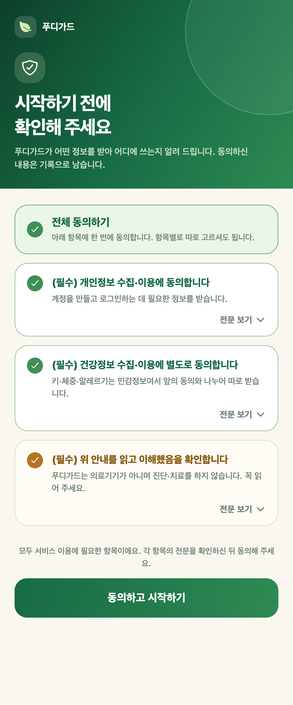
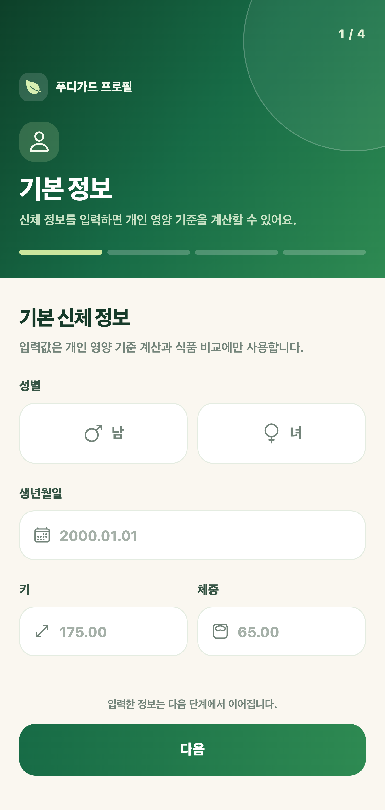

# GKE 기반 건강식 장바구니 분석 서비스 FoodiGuard

2026-1 클라우드 캡스톤 팀 프로젝트입니다.  
식약처 통합식품영양성분 DB와 품목제조보고 원재료 DB를 매칭한 **식품 79,041건(원재료 약 90만 행)** 을 기반으로 식품 검색, 개별 식품 점수, 원재료·알레르기 분석, 장바구니 영양 분석과 대체식품 추천을 제공하는 모바일 서비스입니다.

단순히 앱을 만드는 데서 끝내지 않고, **GCP 위에 배포하고(GKE·Cloud SQL), 자동 배포(Jenkins)와 인프라 코드(Terraform)를 갖추고, 모니터링·부하 테스트·장애 실험으로 운영 가능성을 검증**하는 데까지 진행했습니다.  
기말 프로젝트였던 [LangGraph 기반 식단 추천 AI 에이전트](../LangGraph%20기반%20식단%20추천%20AI%20에이전트)를 클라우드 서비스로 확장한 프로젝트이기도 합니다.

> 원본은 팀 저장소에서 개발했고, 이 폴더는 포트폴리오용으로 옮긴 사본입니다. 실제 GCP 프로젝트 ID, 외부 IP, 개인 이메일은 예시 값으로 바꿨습니다.

## 프로젝트 개요

장을 볼 때 식품 하나하나의 영양성분과 원재료를 확인하기는 어렵고, 장바구니 전체로 보면 하루 권장량 대비 얼마나 먹게 되는지 알기 더 어렵습니다.  
FoodiGuard는 식품을 검색하거나 장바구니에 담으면 영양성분과 원재료에서 파생한 위험 요소(첨가당, 감미료, 정제 탄수화물, 나트륨 첨가물, 보존료)를 점수로 보여주고, 알레르기 식품을 제외한 더 나은 대체식품을 추천합니다.

## 내가 맡은 역할

팀 저장소 커밋 111개 중 41개를 작성했습니다.

- **모바일 앱**: Expo(React Native) 기반 앱을 처음 구성하고 화면 디자인을 다듬었습니다. 웹 버전(Vite)을 정리해 모바일 앱 하나로 통합했습니다.
- **점수·추천 로직**: 새 식품 DB 스키마에 맞춰 원재료·알레르기 기능을 연결하고, 점수 등급을 5단계로 조정했습니다. 가중합 방식이던 추천기를 **하드 필터 + 점수 정렬** 방식으로 바꾸고, 대체식품 API와 카테고리 단계별 대체 로직을 만들었습니다.
- **배포**: 컨테이너 빌드를 고치고 Docker Compose 배포 구성을 추가했습니다. 관리형 PostgreSQL 지원과 작은 인스턴스에서도 버티는 헬스체크를 만들었습니다.
- **검색 성능**: 앱이 실제로 거치는 DB 뷰에서 **부분 인덱스가 한 번도 쓰이지 않던 문제**를 찾아 고쳤습니다. 기본 목록 응답이 운영 환경에서 361ms → 24ms(약 15배)로 줄었습니다.
- **관측성·운영**: API에 Prometheus 메트릭을 노출하고 GKE 관리형 수집을 연결했습니다. 알림 정책과 비용 라벨을 Terraform으로 관리하도록 옮기고, 데이터 적재 중단·데이터 노후화 알림을 추가했습니다.
- **SRE 검증**: 알림·부하·통제된 장애 실험 결과를 기록했습니다.
- **개인정보**: 건강 정보를 저장하기 전에 명시적 동의를 받는 화면과 프로필 소유권 검증을 추가했습니다.

## 시스템 구조

```text
GitHub ──▶ Jenkins VM (Compute Engine)
              │  이미지 빌드 · Artifact Registry 푸시
              │  DB 마이그레이션 Job 실행 후 배포 갱신
              ▼
         GKE Autopilot (asia-northeast3)
           ├─ foodiguard-web  (Nginx + 웹 빌드, LoadBalancer)
           ├─ foodiguard-api  (Express API + Cloud SQL Proxy 사이드카)
           ├─ 마이그레이션 Job · 데이터 동기화 Job · 알레르기 집계 CronJob
           └─ HPA · PodDisruptionBudget · PodMonitoring
              │
              ├─▶ Cloud SQL PostgreSQL 17 (pg_trgm)
              ├─▶ Vertex AI Gemini (장바구니 AI 코치 설명)
              └─▶ Cloud Monitoring / Managed Prometheus (알림 7종)
```

자세한 구조는 [docs/gcp-architecture.md](./docs/gcp-architecture.md)에 정리되어 있습니다.

## 핵심 기능

- **식품 검색**: 원재료 분석이 끝난 식품 79,041건을 검색합니다. `pg_trgm` 인덱스와 띄어쓰기 무시 정규화를 사용합니다.
- **개별 식품 점수**: 영양성분과 원재료에서 파생한 플래그를 함께 반영합니다.
- **원재료 상세**: 표시 순서 그대로의 전체 원재료, 16종 알레르기 경고, 데이터 변경 이력을 보여줍니다.
- **알레르기 제외 검색**: `?excludeAllergens=밀,우유`처럼 알레르기 식품을 안전하게 제외합니다.
- **장바구니 분석**: 권장량 대비 누적 영양, 위험도, 대체식품 추천, Gemini 기반 AI 코치 설명을 제공합니다.

## 사용 기술

- 모바일: `React Native (Expo)`, `React 19`
- 백엔드: `Node.js`, `Express`, `PostgreSQL 17 (pg_trgm)`
- AI: `Vertex AI Gemini`
- 인프라: `GCP` — `GKE Autopilot`, `Cloud SQL`, `Artifact Registry`, `Compute Engine`, `Cloud Monitoring`
- 운영: `Docker`, `Kubernetes`, `Terraform`, `Jenkins`, `Managed Prometheus`

## 운영 검증 결과

### 부하 테스트 (동시성 10, 시나리오당 45초)

| 시나리오 | RPS | p95 | 오류율 |
| --- | --- | --- | --- |
| 기본 목록 | 106.0 | 117 ms | 0% |
| 키워드 검색 | 3.2 | 3,792 ms | 0% |
| 알레르기 제외 | 5.1 | 3,520 ms | 0% |

부하 중 API 파드 CPU는 0.035코어였지만 Cloud SQL CPU는 91%였습니다. **병목이 API가 아니라 1 vCPU DB**라는 것을 측정으로 확인했고, API 복제본을 늘리기보다 검색 경로의 인덱스를 먼저 고쳐야 한다는 결론을 냈습니다.

### 통제된 장애 실험

API 파드를 강제로 삭제하고 외부 진입점을 0.5초 간격으로 호출했습니다.

- 쿠버네티스가 파드를 즉시 다시 만들어 사람 개입 없이 복구됐고, 완전 정지 구간은 약 4초였습니다.
- 복제본이 1개라서 생긴 정지였기 때문에, 이후 **API 복제본 2개 이상 + PodDisruptionBudget**을 적용했습니다.
- 가용성 알림의 지속 조건(3분)보다 자동 복구(4초)가 빨라 알림이 울리지 않는다는 점도 확인했습니다.

자세한 기록은 [docs/sre-validation.md](./docs/sre-validation.md), [docs/performance.md](./docs/performance.md)에 있습니다.

## 실행 화면

| 개인정보·건강정보 동의 | 온보딩 (기본 정보) |
| --- | --- |
|  |  |

## 확인할 파일

- `mobile/`
  - Expo(React Native) 모바일 앱
- `backend/server/`
  - Express API, 점수·추천 엔진, 검색 쿼리, Prometheus 메트릭
- `k8s/`
  - Deployment, Service, HPA, PDB, 마이그레이션·데이터 동기화 Job
- `infra/gcp/terraform/`
  - GCP 리소스, 알림 정책, 비용 라벨을 관리하는 Terraform 코드
- `Jenkinsfile`
  - 빌드 → 이미지 푸시 → 마이그레이션 → 배포 파이프라인
- `docs/`
  - 아키텍처, 성능 개선, 관측성, SRE 검증, FinOps 기록
- `docs/SETUP.md`
  - 로컬 실행과 배포 방법 (원본 저장소 README)

## 프로젝트 의미

서비스를 클라우드에 올리는 것과, **올린 서비스가 실제로 버티는지 측정하고 근거를 갖고 개선하는 것**은 다르다는 것을 배운 프로젝트입니다.  
부하 테스트로 병목이 DB라는 것을 찾고, 실행계획을 확인해 죽어 있던 인덱스를 고치고, 장애 실험 결과로 복제본과 PDB를 추가하는 과정을 거치면서 클라우드 인프라와 운영(SRE)에 대한 관심이 구체적인 진로 목표가 되었습니다.
