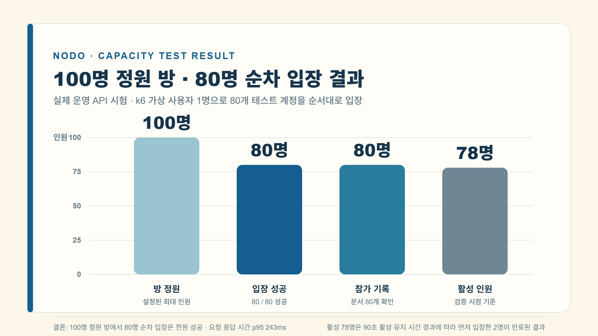
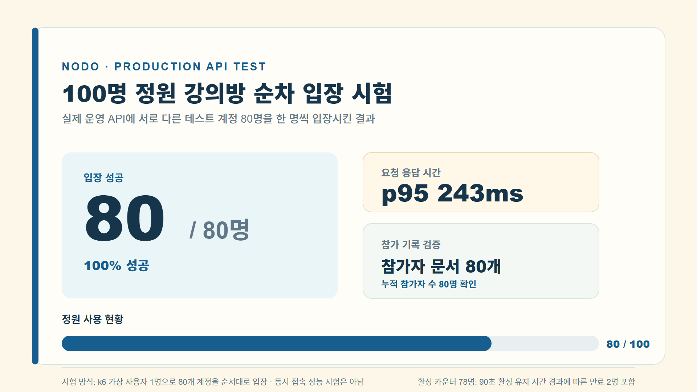
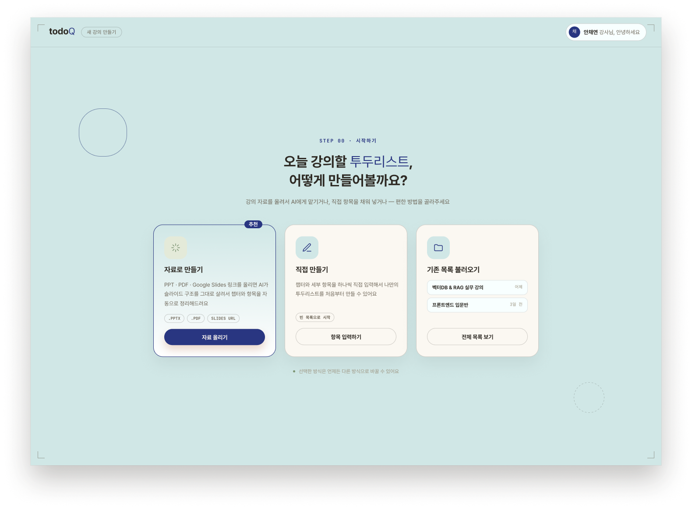
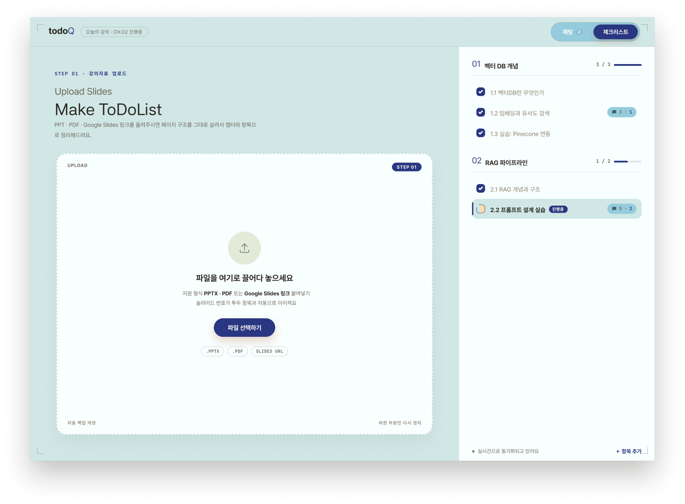
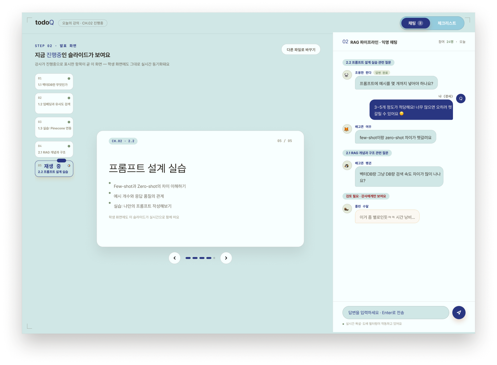
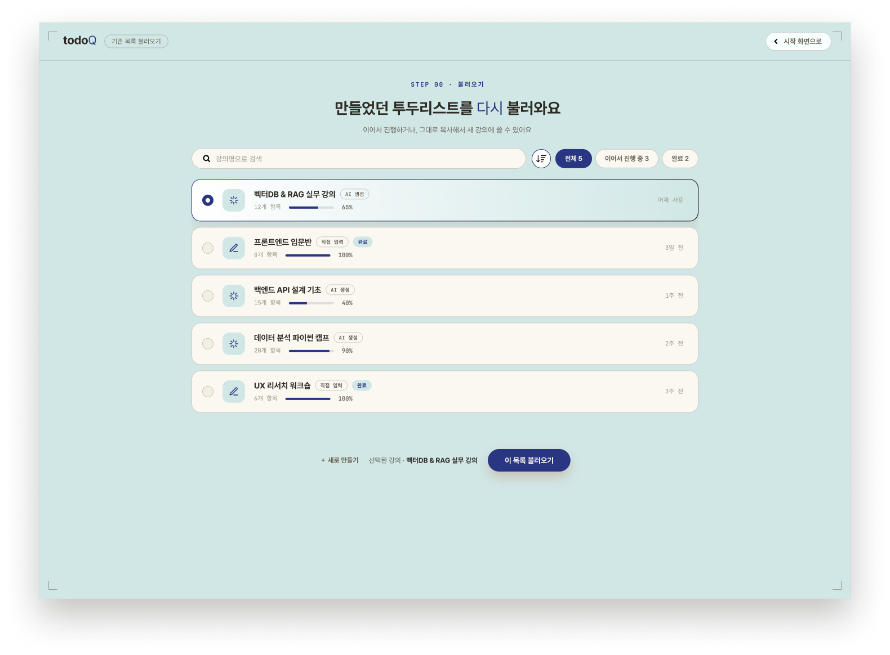

# Google Cloud 기반 수업 운영 플랫폼 NoDo

인턴십 기간에 진행한 **Google Cloud 교과 연계 산학 팀 프로젝트**입니다.  
강사가 강의 자료(PDF·PPTX)를 올리면 AI가 수업 로드맵 초안을 만들고, 학생은 공유 링크로 입장해 현재 진행 위치와 다음 활동을 보면서 질문할 수 있는 **AI 기반 수업 로드맵 및 실시간 강의 운영 플랫폼**입니다.

프론트엔드가 클라우드 저장소에 직접 접근하지 않는 **React → FastAPI → Google Cloud** 구조로 만들고, Cloud Run·Firestore·Cloud Storage·Vertex AI를 사용하는 서버리스 서비스로 배포했습니다.

> 원본은 팀 저장소에서 개발했고, 이 폴더는 포트폴리오용으로 옮긴 사본입니다. 실제 GCP 프로젝트 ID, 서비스 주소, 협력 기업의 조직·도메인 정보는 예시 값으로 바꿨고, 인수인계용 접근권한 문서는 제외했습니다.

## 프로젝트 개요

학생이 많은 수업에서는 강사가 모든 학생의 진행 상황을 바로 확인하기 어렵고, 학생은 설명을 한 번 놓치면 이후 흐름을 따라가기 어렵습니다.  
NoDo는 자료, 학습 순서, 수업 운영 정보, 학생 질문을 하나의 흐름으로 연결해 이 문제를 줄이는 것을 목표로 했습니다.

- 강사는 자료를 업로드하거나 직접 로드맵을 작성하고, 학생에게 링크나 방 코드로 공유합니다.
- 학생은 수업 중 현재 항목과 다음 활동을 확인하고, 놓친 부분은 로드맵에 연결된 자료로 다시 돌아갈 수 있습니다.
- 수업이 끝난 뒤에도 강사가 허용한 기간 동안 자료를 다시 볼 수 있습니다.

## 내가 맡은 역할

팀원 1명과 백엔드·클라우드를 함께 맡았고, 그중 **클라우드 인프라 쪽 비중을 높여** 작업했습니다.

### 클라우드 인프라·배포

- 여러 서비스가 함께 쓰는 GCP 프로젝트 안에서 자원이 섞이지 않도록 **Firestore 데이터베이스·Storage 버킷·서비스 계정 단위로 자원 경계**를 나누고 명명 규칙을 정했습니다. ([자원 경계 문서](./docs/RESOURCE_BOUNDARIES.md))
- Cloud Run 런타임 서비스 계정에는 NoDo의 Firestore, 전용 버킷, Vertex AI에 필요한 **최소 권한만** 부여하고, 서비스 계정 JSON 키 없이 Application Default Credentials로 인증하도록 구성했습니다.
- FastAPI를 컨테이너로 만들어 Cloud Run(asia-northeast3)에, 웹을 Firebase Hosting에 배포하는 구성을 잡았습니다. 프로젝트·버킷·CORS 설정이 정해진 경계와 다르면 **시작 자체를 멈추는(fail-closed)** 방식으로 잘못된 자원에 연결되는 사고를 막았습니다. ([배포 문서](./docs/NODO_PRODUCTION_DEPLOYMENT.md))
- Firebase Emulator 모드와 실제 클라우드 모드를 분리해, 로컬 개발과 테스트가 운영 데이터에 닿지 않도록 했습니다.

### 저장소·동시성 (백엔드 공동 작업)

- 강의 자료를 **비공개 Cloud Storage 버킷**에만 저장하는 업로드 경로를 만들고, 서버에서 PDF·PPTX 형식을 다시 검사하도록 했습니다.
- 개인·수업·조직 단위 저장 용량을 **Firestore 트랜잭션으로 예약 → 확정 → 해제**하는 방식으로 관리해, 여러 자료를 동시에 올려도 한도를 넘지 않게 했습니다.
- 학생 입장 정원과 접속 상태(heartbeat)를 서버 전용 문서에서 트랜잭션으로 관리했습니다.

### 성능 검증

- k6로 실제 운영 API에 80명 순차 입장 시험을 진행했고(p95 약 243ms), **정원 카운터 문서 하나에 쓰기가 몰릴 때 생기는 트랜잭션 경합**을 확인해 카운터 샤딩과 heartbeat 처리 분리를 개선 방향으로 정리했습니다.

## 시스템 구조

```text
브라우저 (React + Vite, Firebase Hosting)
   │  Firebase Authentication (강사: Google 로그인 / 학생: 익명 인증)
   ▼
FastAPI (Cloud Run)  ── 권한·수업 상태·용량 검증을 모두 서버에서 처리
   ├─▶ Cloud Firestore   조직·수업·로드맵·참가자·질문·감사 기록
   ├─▶ Cloud Storage     강의 자료 원본 (비공개 버킷)
   └─▶ Vertex AI Gemini  요청할 때만 로드맵 초안 생성
```

| 서비스 | 활용 내용 |
| --- | --- |
| Firebase Authentication | Google 로그인, 세션 검증, 조직 승인 이메일과 로그인 이메일 일치 확인 |
| Cloud Run | FastAPI 백엔드 운영. 수업·질문·참여자·자료 접근 요청 처리 |
| Cloud Firestore | 조직 구성원, 수업, 로드맵, 참가자, 질문, 권한, 감사 기록 저장 |
| Cloud Storage | PDF·PPTX 강의 자료 원본과 처리 결과 저장 |
| Firebase Hosting | React/Vite 웹 화면 배포 |
| Vertex AI | 업로드한 자료를 바탕으로 로드맵 초안 생성 |

## 핵심 기능

### 1. 자료 기반 로드맵 생성과 편집

- PDF·PPTX를 브라우저와 서버에서 각각 형식 검사한 뒤 비공개 Storage에 저장합니다.
- 강사가 요청하면 Vertex AI Gemini가 정규화된 텍스트만 받아 챕터·항목 단위 로드맵 초안을 만듭니다.
- 편집 화면에서 제목과 설명을 고치고, 챕터·항목 순서를 드래그로 바꿀 수 있습니다.

### 2. 실시간 수업 운영

- 수업 상태를 준비 중(READY), 진행 중(LIVE), 종료됨(ENDED)으로 관리합니다.
- 강사는 정원을 정하고, 학생 입장 링크와 8자리 방 코드를 공유합니다.
- 자료 미리보기와 로드맵 진행 패널을 함께 보여주고, 학생 질문은 해당 항목의 문맥과 함께 기록됩니다.

### 3. 수업 종료 후 자료 열람과 데이터 수명주기

- 종료 후 자료 열람 기간을 즉시·1일·7일·30일·직접 지정 중에서 고릅니다.
- 종료된 수업은 체크리스트 변경과 새 질문을 막아 기록이 바뀌지 않게 합니다.
- 상세 질문·참가 정보 같은 개인정보성 데이터는 열람 마감 이후 정리 대상으로 분류했고, 정리가 늦어져도 API가 마감 이후 다운로드를 먼저 차단합니다.

### 4. 조직·권한·용량 관리

- 관리자가 회사 Google 이메일을 사전 승인하면, 그 사용자가 같은 이메일로 로그인할 때 조직 멤버십이 활성화됩니다.
- 구성원을 제거해도 Google 계정은 지우지 않고 조직 멤버십만 제거하며, 진행 중인 수업의 주 강사 권한은 관리자에게 자동으로 넘어갑니다.
- 자료 업로드는 개인·수업·조직 단위 용량을 바이트 기준으로 검사합니다. 업로드 전에 용량을 **예약**하고, 성공하면 확정하고, 실패하면 해제해 동시 업로드에서도 한도를 넘지 않게 했습니다.

## 사용 기술

- 프론트엔드: `React`, `TypeScript`, `Vite`, `Vitest`
- 백엔드: `Python`, `FastAPI`, `pytest`, `Ruff`
- 클라우드: `Cloud Run`, `Cloud Firestore`, `Cloud Storage`, `Firebase Authentication`, `Firebase Hosting`, `Vertex AI (Gemini)`
- 개발 환경: `Firebase Emulator Suite`(Auth·Firestore·Storage), `Docker`, `k6`

## 구현 포인트

- 브라우저는 Firestore·Storage·Vertex AI에 직접 접근하지 않고 **모든 요청을 FastAPI에서 검증**하도록 해, 역할 기반 권한과 개인정보 최소 노출 원칙을 한곳에서 지켰습니다.
- 로컬 개발은 Firebase Emulator로, 실제 인증 연동은 별도의 `cloud-auth` 모드로 **실행 모드를 분리**했습니다. 필수 환경 변수가 하나라도 빠지면 실제 프로젝트로 추측 연결하지 않고 시작을 멈춥니다.
- 프론트엔드(Vitest) 504개, 백엔드(pytest) 485개 테스트와 Emulator 기반 Firestore 보안 규칙 테스트를 작성해 권한·상태 변경·용량 관리 동작을 검증했습니다.

## 운영 검증

실제 운영 API에서 정원 100명인 임시 수업에 서로 다른 테스트 계정 80명을 순서대로 입장시키는 시험을 했습니다.

- 80명 모두 입장에 성공했고, 입장 API의 p95 응답 시간은 **약 243ms**였습니다.
- 다수 학생의 입장과 heartbeat 요청이 같은 정원 카운터 문서를 갱신할 때 **Firestore 트랜잭션 경합**이 생길 수 있음을 확인했고, 정원 카운터 샤딩과 heartbeat 처리 개선을 다음 과제로 정리했습니다.
- 이 시험은 가상 사용자 1명이 계정을 바꿔 가며 순차로 입장한 방식이라, 80명 동시 접속 성능을 보장하는 결과는 아닙니다.

| 순차 입장 시험 결과 | 시험 요약 |
| --- | --- |
|  |  |

## 화면 디자인 (초기 시안)

| 시작 화면 | 자료 업로드 |
| --- | --- |
|  |  |

| 수업 진행·채팅 | 저장된 수업 불러오기 |
| --- | --- |
|  |  |

## 확인할 파일

- `backend/app/`
  - FastAPI 라우트, 도메인 규칙, Firestore·Storage·Vertex AI 어댑터
- `backend/tests/`
  - 수업 상태, 권한, 질문, 용량 관리, 구성원 관리 테스트
- `web/src/`
  - React 화면과 기능별 모듈, 컴포넌트 테스트
- `firestore.rules`, `storage.rules`, `web/emulator-tests/`
  - 보안 규칙과 Emulator 기반 규칙 테스트
- `docs/`
  - API 계약, Firestore 스키마, 역할·권한, 자원 경계, 배포 문서
- `docs/DEVELOPER_GUIDE.md`
  - 실행 모드, 환경 변수, 로컬 실행 방법 (원본 저장소 README)

## 프로젝트 의미

실제 기업 환경에서 쓸 수 있는 서비스를 목표로, **권한·개인정보·비용·데이터 수명주기까지 함께 설계**해 본 프로젝트입니다.  
서버리스 구조로 상시 서버 비용을 줄이면서도, 성능 시험에서 **한 문서에 쓰기가 몰리는 핫스팟이 트랜잭션 경합으로 이어지는 것**을 직접 확인했습니다.  
관리형 서비스를 쓰더라도 결국 분산 저장소의 일관성과 경합, 자원 격리 같은 시스템 문제를 이해해야 확장 가능한 서비스를 만들 수 있다는 것을 느꼈고, 이것이 클라우드 인프라와 분산 시스템을 더 깊이 공부하고 싶다는 계기가 되었습니다.
