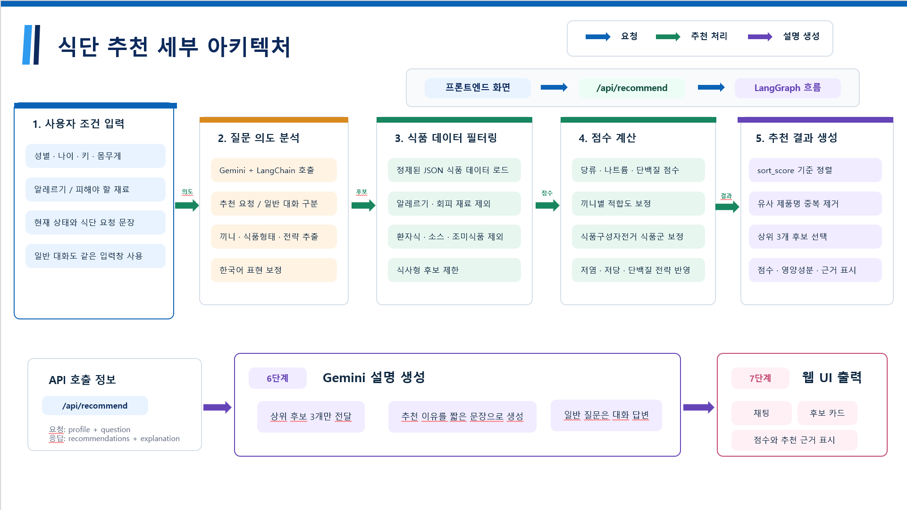
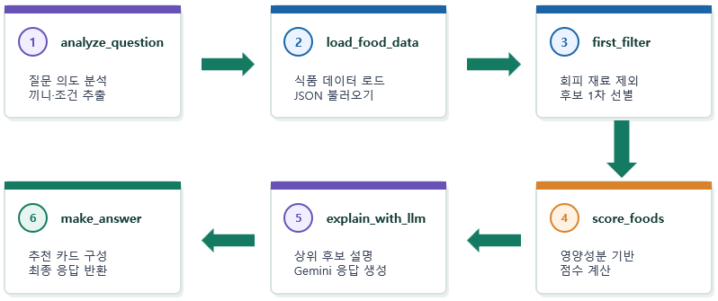
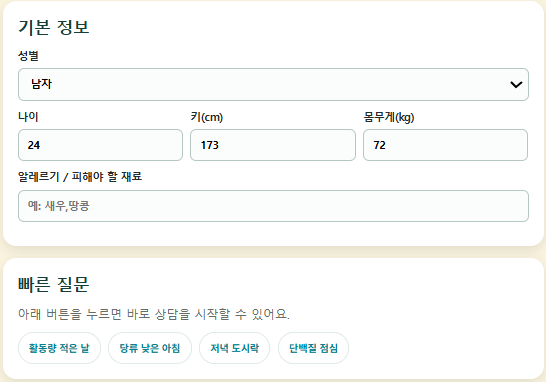
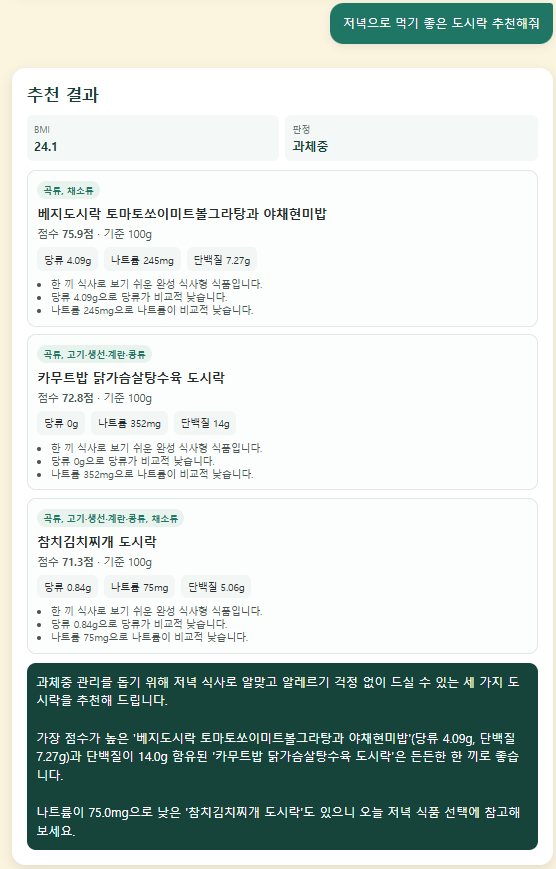
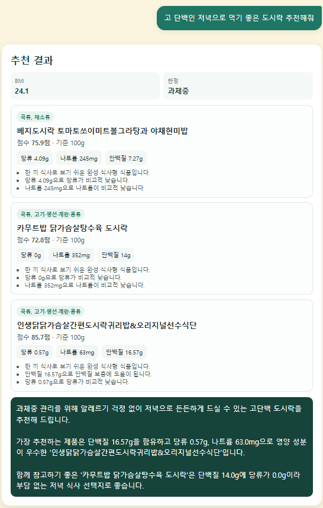
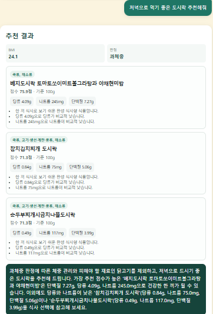
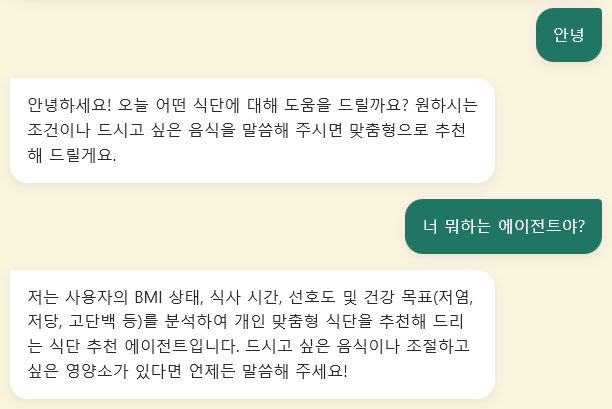

# LangGraph 기반 식단 추천 AI 에이전트 (푸디가드)

`클라우드AI프로그래밍` 기말 프로젝트로 진행한 2인 팀 프로젝트입니다.  
사용자의 기본 정보(성별, 나이, 키, 몸무게, 알레르기)와 자연어 질문을 받아, 식품영양성분 데이터에서 조건에 맞는 식단 후보를 골라 점수와 추천 근거를 함께 보여주는 AI 에이전트입니다.

질문 해석은 `Gemini`가 맡고, 실제 후보 필터링과 점수 계산은 `Python` 로직이 맡도록 역할을 나눠, LLM의 답변이 데이터와 어긋나지 않도록 구성한 점이 핵심입니다.  
이 프로젝트의 아이디어는 이후 클라우드 캡스톤 프로젝트인 [GKE 기반 건강식 장바구니 분석 서비스 FoodiGuard](../GKE%20기반%20건강식%20장바구니%20분석%20서비스%20FoodiGuard)로 확장되었습니다.

## 프로젝트 개요

편의점 도시락, 밀키트처럼 선택할 수 있는 식품은 많아졌지만, 나트륨·당류·단백질을 직접 비교해 고르기는 어렵습니다.  
사용자는 보통 `나트륨 낮은 저녁 추천해줘`, `점심에 짠 걸 먹어서 저녁은 가볍게 먹고 싶어`처럼 자연어로 말하기 때문에, 단순 키워드 검색으로는 의도를 정확히 반영하기 어렵습니다.

이 에이전트는 질문의 의도를 구조화된 조건으로 바꾼 뒤, 약 4만 건의 정제된 식품 데이터에서 후보를 계산하고, 선택된 후보에 대해서만 LLM이 설명을 생성하도록 설계했습니다.

## 내가 맡은 역할

- LangGraph 기반 추천 흐름(`meal_recommendation_agent.py`)을 단계별 노드로 나누어 구현했습니다.
- 질문 의도 분석 결과를 Python 규칙으로 한 번 더 보정하는 로직(`llm_chains.py`)을 만들었습니다.
- 식품영양성분 원본 데이터(약 27만 건)를 일반 식단 추천에 맞게 정제하는 스크립트를 작성했습니다.
- 웹 화면과 서버를 연결하고, 실행 예시와 결과 보고서를 정리했습니다.

## 핵심 기능

### 1. 자연어 질문 의도 분석

- Gemini가 질문에서 끼니, 식품 형태, 줄이고 싶은 영양소, 추천 전략을 JSON으로 추출합니다.
- `저염`, `덜 짠`, `나트륨 낮게`는 `low_sodium`으로, `나트륨이 좀 있는`은 `moderate_sodium`으로 Python에서 다시 보정합니다.
- `안녕`처럼 식단과 관계없는 질문은 일반 대화로 분류해 추천 흐름을 타지 않습니다.

### 2. 데이터 기반 후보 필터링과 점수 계산

- 알레르기·피해야 할 재료가 들어간 식품을 먼저 제외합니다.
- 환자식, 특수의료용 식품, 소스·양념처럼 한 끼 식사로 보기 어려운 항목을 걸러냅니다.
- 나트륨, 당류, 단백질, 끼니 적합도, 식품구성자전거 기반 식품군 균형으로 점수를 계산합니다.
- 비슷한 상품이 반복 추천되지 않도록 유사 제품을 제거합니다.

### 3. BMI 기반 개인화

- 키와 몸무게로 BMI를 계산하고 대한비만학회 기준으로 저체중·정상·과체중·비만을 판정합니다.
- 판정 결과를 화면에 보여주고, 당류·나트륨이 높은 식품의 점수 보정에도 반영합니다.

### 4. 추천 근거 생성

- Python이 고른 상위 후보만 Gemini에 전달해 짧은 추천 이유를 생성합니다.
- 결과는 식품명, 점수, 주요 영양성분, 추천 근거가 담긴 카드로 표시됩니다.

## 사용 기술

- `Python`
- `LangChain`, `LangGraph`
- `Gemini API (langchain-google-genai)`
- `HTML`, `CSS`, `JavaScript`
- 식품의약품안전처 식품영양성분 데이터

## 구현 포인트

- LLM이 직접 상품을 고르지 않고, **질문 해석 → 데이터 필터링 → 점수 계산 → 설명 생성**으로 역할을 분리해 추천 결과가 실제 데이터에 근거하도록 했습니다.
- 추천 흐름을 LangGraph 노드로 나눠, 결과가 이상할 때 의도 분석·필터링·점수 계산 중 어느 단계 문제인지 바로 추적할 수 있게 했습니다.
- 개발 중 환자식·투석식이 추천되는 문제를 발견해, 데이터 정제 규칙과 검증 스크립트(`scripts/check_clean_products.py`)를 추가했습니다.
- API 키는 코드에 넣지 않고 `.env`에서 읽도록 했고, 저장소에는 `.env.example`만 포함했습니다.

## 시스템 구조



### LangGraph 추천 흐름

`analyze_question → load_food_data → first_filter → score_foods → explain_with_llm → make_answer`



## 실행 화면

### 1. 기본 정보 입력



### 2. 질문 조건에 따라 달라지는 추천

같은 사용자 정보에서도 `저녁 도시락`과 `고단백 저녁 도시락` 요청의 추천 결과가 달라집니다.

| 저녁 도시락 요청 | 고단백 저녁 도시락 요청 |
| --- | --- |
|  |  |

### 3. 피해야 할 재료 반영

피해야 할 재료에 `닭`을 입력하면 닭고기가 들어간 후보가 제외되고 다른 도시락이 추천됩니다.



### 4. 일반 대화 구분



## 실행 방법

```bash
pip install -r requirements.txt
cp .env.example .env   # GOOGLE_API_KEY 입력
python server.py
```

브라우저에서 `http://127.0.0.1:8008/`로 접속합니다.  
식품 데이터는 용량 때문에 `data/full_products.json.gz`로 압축해 두었고, 코드가 압축 파일을 그대로 읽습니다.

## 확인할 파일

- `meal_recommendation_agent.py`
  - LangGraph 상태 그래프와 필터링·점수 계산 로직
- `llm_chains.py`
  - Gemini 기반 질문 의도 분석, 의도 보정, 추천 설명 생성
- `food_group_rules.py`
  - 식품구성자전거 기준 식품군 분류 규칙
- `health_profile.py`
  - BMI 계산과 비만도 판정
- `server.py`, `web/`
  - 웹 서버와 프론트엔드 화면
- `scripts/build_clean_products.py`, `scripts/check_clean_products.py`
  - 원본 식품 데이터 정제와 정제 결과 검증

## 한계와 개선 방향

- 식품 데이터가 1회 제공량 기준과 100g 기준이 섞여 있어, 단위를 통일하면 영양소 비교 정확도를 높일 수 있습니다.
- 상품명 키워드로 식품군을 분류하기 때문에, 여러 반찬이 섞인 도시락은 분류가 부정확할 수 있습니다.
- 추천 결과는 의료적 식단 처방이 아니라 일반적인 식품 선택을 돕는 참고용입니다.

## 프로젝트 의미

LLM만으로 답을 만드는 것보다, **LLM은 의도 해석과 설명에 쓰고 실제 계산은 코드가 맡는 구조**가 더 안정적이라는 것을 직접 확인한 프로젝트입니다.  
이 경험이 이후 데이터 규모와 사용자가 늘어나는 상황을 다루는 클라우드 기반 서비스로 확장하는 출발점이 되었습니다.
